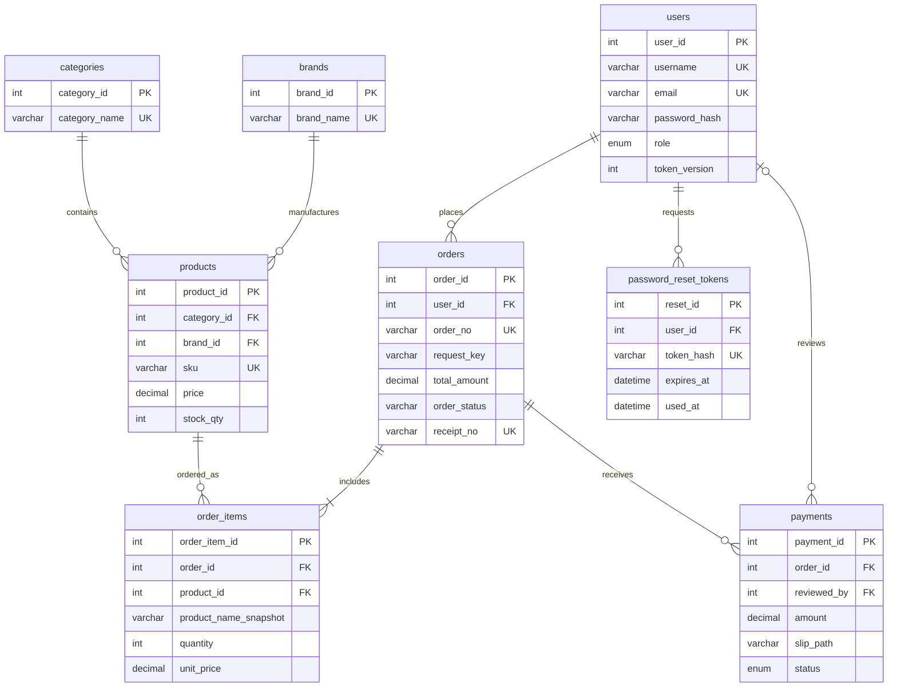

# โครงงานระบบจำหน่ายผลิตภัณฑ์โปรไบโอติกออนไลน์

**Probiotic Shop — Database Web Application** 
Vue.js + Node.js + MySQL/MariaDB 
จัดทำตามโจทย์ Project ครั้งที่ 1–2 ปรับปรุงหลังตรวจครบ วันที่ 20 ตุลาคม 2569

## ผู้จัดทำ

| ชื่อ | รหัสนักศึกษา |
| --- | --- |
| กฤตพร ธัญญเจริญ | 1167109060083 |
| ธีทัต แจ่มแจ้ง | 1167109060513 |
| อนันตสิน เสาร์แก้ว | 1167109060547 |

## 1. ความต้องการของระบบ

### วัตถุประสงค์และขอบเขต

สร้างร้านค้าสาธิตเพื่อจัดการข้อมูลสินค้า สมาชิก คำสั่งซื้อ การแจ้งชำระเงิน ใบเสร็จ และการวิเคราะห์ยอดขาย ผู้ใช้สามารถทำรายการตั้งแต่สมัครสมาชิกจนถึงรับใบเสร็จได้ มีการแบ่งสิทธิ์ด้วย JWT และจัดเก็บข้อมูลในฐานข้อมูลเชิงสัมพันธ์

ระบบสาธิตไม่เชื่อมธนาคารหรือ payment gateway ไม่มีการตัดเงินจริง การชำระเงินในโจทย์ดำเนินการโดยกรอกยอด วันเวลา และแนบหลักฐาน จากนั้น Admin ตรวจสอบยืนยัน

### ผู้ใช้และฟังก์ชัน

| ผู้ใช้ | ความต้องการ |
| --- | --- |
| ผู้เยี่ยมชม | ดูหน้าแรกและข้อมูลติดต่อ สมัครสมาชิก เข้าสู่ระบบ ขอรีเซ็ตรหัสผ่าน |
| Customer Member | ดู/ค้นหา/กรองสินค้า เลือกสินค้าตามรหัส ใส่ตะกร้า ระบุจำนวน/ข้อมูลจัดส่ง สั่งซื้อ ดูรายการของตน แจ้งชำระ ดาวน์โหลดเอกสาร ยกเลิกรายการที่ยังไม่แจ้งชำระ |
| Admin | ใช้งานตามสมาชิก เพิ่ม/แก้ไข/ลบแบบซ่อน/ค้นหาสินค้า เพิ่มหมวดหมู่และแบรนด์ ดูทุกออร์เดอร์ ตรวจหลักฐาน อนุมัติหรือส่งกลับพร้อมเหตุผล ดู dashboard ยอดขายรายวัน |

### ข้อกำหนดข้อมูลและกฎธุรกิจ

1. Username และอีเมลไม่ซ้ำ รหัสผ่านขั้นต่ำ 8 ตัว มี A-Z, a-z, ตัวเลขและอักขระพิเศษ จำกัด 72 bytes ตาม bcrypt เก็บเฉพาะ hash
2. Public registration ได้สิทธิ์ customer เสมอ Admin ถูกสร้างผ่านขั้นตอนจัดการเฉพาะ ไม่รับสิทธิ์จากผู้สมัคร
3. API ที่จำกัดสมาชิกตรวจลายเซ็น JWT วันหมดอายุ บัญชีปัจจุบันและ token_version ฝั่งเซิร์ฟเวอร์เสมอ
4. สินค้าสังกัดหนึ่งหมวดหมู่และหนึ่งแบรนด์ ราคาไม่ติดลบ จำนวนคงเหลือเป็นจำนวนเต็มไม่ติดลบ
5. คำสั่งซื้อมีอย่างน้อยหนึ่งรายการ ราคาคำนวณจาก DB ในหน่วยสตางค์ ไม่เชื่อราคาจาก browser บันทึกชื่อ SKU และราคาขณะสั่งซื้อเป็น snapshot
6. จองสต็อกเมื่อสร้างออร์เดอร์ ใช้ transaction และล็อกแถวสินค้า เรียง product_id ก่อนล็อก ป้องกันขายเกินสต็อก
7. Request key ไม่ซ้ำต่อสมาชิก ป้องกันสร้างออร์เดอร์ซ้ำจากการกดยืนยันหรือ retry
8. ยกเลิกได้เฉพาะ awaiting_payment และคืนสต็อกครั้งเดียว ไม่ลบประวัติ
9. แจ้งโอนยอดตรงกับ total_amount เวลาไม่เป็นอนาคต/ก่อนสั่งซื้อ แนบ JPG/PNG/PDF สูงสุด 5 MB หลักฐานเข้าถึงได้เฉพาะเจ้าของหรือ Admin
10. แจ้งชำระสำเร็จจะได้ใบรับแจ้งชำระ PDF ระบุว่ารอตรวจสอบ เมื่อ Admin อนุมัติจึงเป็นใบเสร็จรับเงิน มี receipt_no และวันที่ออก
11. หลักฐานถูกปฏิเสธจะแสดงเหตุผลและเปิดแจ้งใหม่ได้ ไม่รวมยอดที่ถูกปฏิเสธ/รอตรวจใน dashboard
12. Dashboard รวมเฉพาะ approved ตาม reviewed_at โดยใช้เวลาไทย UTC+7 และเลือกช่วงวันที่ได้
13. Reset token สุ่ม 32 bytes เก็บ SHA-256 อายุ 15 นาที ใช้ครั้งเดียว ล็อกข้อมูลใน transaction และยกเลิก JWT เดิมหลังเปลี่ยนรหัสผ่าน
14. ไม่เปิดเผย token รีเซ็ตผ่าน public API ไม่บอกว่ามีอีเมลอยู่หรือไม่ ส่งลิงก์ผ่าน SMTP ที่ตั้งค่าไว้

15. Admin เลือกรูป JPG/PNG ไม่เกิน 5 MB จากเครื่องได้ ไฟล์เก็บ image/pdimages โดยสลิปและใบเสร็จแยก image/slip และ image/receipt
16. การแก้สินค้าตรวจ expected_version และเพิ่ม version ทุกครั้งที่แก้/จอง/คืนสต็อก หากข้อมูลเก่าต้องโหลดใหม่
17. ตะกร้าโหลดราคา/สต็อกล่าสุดและต้องยืนยันอีกครั้งเมื่อเปลี่ยน Server ตรวจ expected_unit_price และ expected_total ภายใน transaction
18. คำสั่งซื้อรอชำระหมดอายุใน 24 ชั่วโมง (ปรับผ่าน ORDER_PAYMENT_HOURS) ระบบตรวจทุกนาทีและก่อนอ่าน/ชำระคำสั่งซื้อ คืนสต็อกเพียงครั้งเดียว สถานะ pending_review ไม่ถูกหมดอายุระหว่างตรวจหลักฐาน
19. Admin บันทึกบริษัทขนส่ง/เลขพัสดุและยืนยันสำเร็จได้หลังอนุมัติชำระ ลูกค้าดูสถานะและดาวน์โหลดใบเสร็จได้ตลอด
20. Dashboard export CSV/JSON ตามข้อมูลที่แสดง มีโหมดสว่าง/มืด ตัวอักษรใหญ่ และ pagination ในรายการสินค้า/คำสั่งซื้อ/การชำระ

### การใช้งานและคุณภาพ

รองรับหน้าจอคอมพิวเตอร์และมือถือ ฟอร์มมี label และ validation มีสถานะกำลังทำงาน/ผิดพลาด/ไม่มีข้อมูล ใช้ SQL parameterization เก็บ secret ใน .env ไม่รวมไว้ในซอร์สหรือเอกสารเผยแพร่

## 2. ER Diagram

สมาชิกหนึ่งคนมีหลายคำสั่งซื้อ คำสั่งซื้อหนึ่งรายการมีหลาย order_items สินค้าหนึ่งชนิดอยู่ในหลาย order_items จึงใช้ order_items แก้ความสัมพันธ์ M:N คำสั่งซื้อมีประวัติแจ้งชำระได้หลายครั้งเมื่อหลักฐานก่อนหน้าถูกปฏิเสธ แต่แอปอนุญาต pending/approved ที่ใช้งานอยู่ได้ครั้งละหนึ่งรายการ Admin ผู้ตรวจเป็นสมาชิกที่มี role admin; reviewed_by เป็น NULL ก่อนตรวจ

## 3. Mapping เป็น Relational Schema

- **users** (user_id PK, username UK, email UK, password_hash, full_name, phone, role, created_at, token_version)
- **categories** (category_id PK, category_name UK)
- **brands** (brand_id PK, brand_name UK)
- **products** (product_id PK, category_id FK → categories, brand_id FK → brands, sku UK, product_name, description, price, stock_qty, image_path, is_active, version, package_size, usage_instructions, storage_instructions, caution)
- **orders** (order_id PK, user_id FK → users, order_no UK, recipient_name, recipient_phone, shipping_address, subtotal, shipping_fee, total_amount, order_status, tracking_no, receipt_no UK, receipt_issued_at, created_at, request_key, request_hash, expires_at, carrier, shipped_at, delivered_at, UNIQUE(user_id, request_key))
- **order_items** (order_item_id PK, order_id FK → orders, product_id FK → products, product_name_snapshot, sku_snapshot, quantity, unit_price)
- **payments** (payment_id PK, order_id FK → orders, amount, payment_method, transferred_at, slip_path, status, reviewed_by FK → users, reviewed_at, rejection_reason, created_at)
- **password_reset_tokens** (reset_id PK, user_id FK → users, token_hash UK, expires_at, used_at, created_at)

ตารางใช้ InnoDB/utf8mb4 ไม่ลบสินค้าแบบ physical delete เพื่อคง foreign key และประวัติ ชื่อ/ราคา snapshot จงใจซ้ำจากสินค้าเพื่อเก็บหลักฐานขณะซื้อ ราคาใช้ DECIMAL(10,2) และการคำนวณใน server ใช้จำนวนเต็มหน่วยสตางค์

## 4. Data Dictionary

ดู [DATA_DICTIONARY.md](DATA_DICTIONARY.md) ซึ่งแจกแจงทุกคอลัมน์จากฐานข้อมูลจริง พร้อมชนิดข้อมูล Null, Key, Default, ความหมาย และ foreign keys

## 5. ฐานข้อมูลและการติดตั้ง

โครงสร้างยึดไฟล์ SQL ที่ได้รับ ไม่ import ทับข้อมูลเดิม ขั้นตอน `npm run db:setup` สร้างตารางที่ยังไม่มี และเพิ่มคอลัมน์ version/รายละเอียดสินค้า/deadline/จัดส่ง/request hash และ constraints ที่ยังไม่มี โดยไม่ลบข้อมูล รันซ้ำได้ และ server ตรวจ migration ก่อนเปิดรับคำขอ

- `backend/database/schema.sql`: โครงสร้างสุดท้าย ไม่มีข้อมูลบัญชีจริง
- `backend/database/catalog.sql`: ตัวอย่างหมวดหมู่ แบรนด์ สินค้าสาธารณะ
- `backend/database/probiotic_shop_complete.sql`: โครงสร้างรวมตัวอย่างสินค้าสำหรับฐานข้อมูลใหม่
- `npm run demo:seed`: เพิ่มบัญชีสาธิตถ้ายังไม่มี ไม่เปลี่ยนรหัสผ่านบัญชีเดิม

ดูขั้นตอนเปิดระบบและค่า environment ใน [README.md](../README.md)

## 6. ขั้นตอนสาธิตโปรแกรม

1. หน้า Home → ติดต่อเรา แสดงสถานที่ โทรศัพท์ และผู้จัดทำ → สมัครสมาชิกด้วยรหัสผ่านตามเงื่อนไข
2. Login เป็น customer → ค้นหาหรือกรองหมวดหมู่ → เพิ่มสินค้า → ระบุจำนวนและที่อยู่ในตะกร้า → ยืนยันออร์เดอร์
3. แสดงรายการจาก orders/order_items และยอดเงินจริง → กรอกเวลาโอน/แนบหลักฐานตัวอย่าง → แสดงแจ้งชำระสำเร็จ → เปิดใบรับแจ้งชำระ PDF
4. Login เป็น Admin ในอีกเบราว์เซอร์/โปรไฟล์ → เพิ่ม แก้ไข ค้นหา ซ่อน/เปิดสินค้า → ตรวจชำระ → ดาวน์โหลดหลักฐาน → ยืนยันรับชำระ
5. กลับบัญชีลูกค้า อัปเดตสถานะ → ชำระเงินเรียบร้อย → ดาวน์โหลดใบเสร็จ PDF ที่มี receipt_no
6. เปิด Dashboard เลือกวันที่ → ยอดขายรวม รายวัน จำนวนคำสั่งซื้อ สินค้าขายดี และสินค้าใกล้หมด
7. ทดสอบลืมรหัสผ่านด้วยอีเมลที่รับได้จริงและตั้งค่า SMTP → เปิดลิงก์ในอีเมล → ตั้งรหัสผ่านใหม่ → token เดิมและ session เดิมใช้ไม่ได้
8. ทดสอบ JWT ด้วยไฟล์ Postman collection ตาม [POSTMAN_GUIDE.md](POSTMAN_GUIDE.md)

## 7. ตารางตรวจตามข้อกำหนด

| ข้อโจทย์ | สิ่งที่จัดทำ |
| --- | --- |
| 1–4 | ความต้องการ ER Diagram Mapping Schema และ Data Dictionary ในรายงานนี้ |
| 5 | MySQL/MariaDB, schema, complete SQL, setup/migration |
| 6.1 | หน้า Home ด้วย Vue.js และ Node.js API |
| 6.2 | หน้า Contact พร้อมรายชื่อผู้จัดทำและข้อมูลติดต่อที่อ้างอิงมหาวิทยาลัย |
| 6.3 | Admin เพิ่ม แก้ไข ซ่อน/ลบ และค้นหา รวมข้อมูลหมวดหมู่/แบรนด์ |
| 6.4 | หน้า Products แสดงสินค้า ราคา จำนวนคงเหลือ และเลือกใส่ตะกร้า |
| 6.5–6.6.4 | สมัคร/Login JWT และตรวจสิทธิ์ทั้งหน้าเว็บกับ API; มี Postman collection |
| 6.6.5 | Forgot/reset ผ่านอีเมลที่ลงทะเบียนพร้อม token ใช้ครั้งเดียว |
| 6.6.6 | Password policy และ bcrypt hashing |
| 7–8 | ดึงสินค้า DB และเลือกออร์เดอร์ตาม product_id |
| 9–10 | INSERT orders/order_items พร้อมหน้ารายละเอียดก่อนชำระ |
| 11–12 | ฟอร์มผู้ซื้อ/ยอด/เวลา/หลักฐาน และ INSERT payments |
| 13 | หน้าแจ้งชำระสำเร็จ/ชำระเรียบร้อย พร้อมปุ่มเอกสาร |
| 14 | PDF ภาษาไทย แยกใบรับแจ้งและใบเสร็จหลังยืนยัน |
| 15 | Dashboard ยอดขายรายวันและสรุปการขาย |
| 16 | หมวดหมู่สินค้าและออกแบบการใช้งานให้สัมพันธ์กัน |

## 8. การทดสอบและข้อจำกัดของหลักฐาน

ผลล่าสุด: ติดตั้ง/Integration ผ่าน 9 tests, frontend CSV ผ่าน 2 tests, Postman JWT/Admin 16 requests / 22 assertions, reset ผ่าน SMTP ภายในเครื่อง 11 requests / 13 assertions, SMTP ผู้ให้บริการ verify ผ่านโดยไม่ส่งจดหมายจริง และ build ผ่าน 112 modules

ชุด integration ใช้ฐานข้อมูลทดสอบแยกและลบทิ้งเมื่อจบ ครอบคลุมสิทธิ์ JWT การกำหนด role ไม่ได้ การจัดการสินค้า ราคาจริง idempotency การจอง/คืนสต็อก คำขอพร้อมกัน การเป็นเจ้าของออร์เดอร์ หลักฐาน การอนุมัติ/ปฏิเสธ ใบเสร็จ dashboard และ reset token/session revocation

ชุด browser ตรวจอัปโหลดรูปสินค้า/คงรูปเดิม/ป้องกันสต็อกเก่า/ยืนยันราคาใหม่/เลขพัสดุและจัดส่งสำเร็จ/ธีมและตัวอักษรใหญ่/CSV-JSON export และเปิด Edge headless ใช้งานผ่านหน้าจอจริงทั้งสมัคร/Login ค้นหาสินค้า สั่งซื้อ อัปโหลดหลักฐาน Admin เพิ่ม/ค้นหาสินค้า ยืนยันรับชำระ dashboard ดาวน์โหลด PDF และเมนูมือถือ ข้อมูลทดสอบและหลักฐานแยกจากข้อมูลจริง

การทดสอบ reset จำลองบริการส่งอีเมลในชุดทดสอบเพื่อไม่ส่งอีเมลหาบุคคลจริง การรับอีเมลผ่านผู้ให้บริการจริงต้องมี SMTP ที่ใช้งานได้และอีเมลผู้รับที่เข้าถึงได้ ไม่ถือผล mock เป็นหลักฐานว่ากล่องจดหมายจริงได้รับอีเมล

## แหล่งอ้างอิงข้อมูลติดต่อ

ใช้ข้อมูลสถานที่และหมายเลขโทรศัพท์ของ **กองประชาสัมพันธ์ มทร.ธัญบุรี** ตามคำขอสำหรับร้านสาธิต: https://prd.rmutt.ac.th/contact-us/ 
39 หมู่ 1 ตำบลคลองหก อำเภอคลองหลวง จังหวัดปทุมธานี 12120 โทรศัพท์ 02 549 4990–2 
ข้อมูลนี้ไม่แสดงว่ามหาวิทยาลัยจำหน่ายสินค้าหรือรับรองร้าน บัญชีธนาคารเป็น DEMO-PROBIOTIC-0001 ชื่อ Probiotic Shop ไม่มีการโอนเงินจริง
